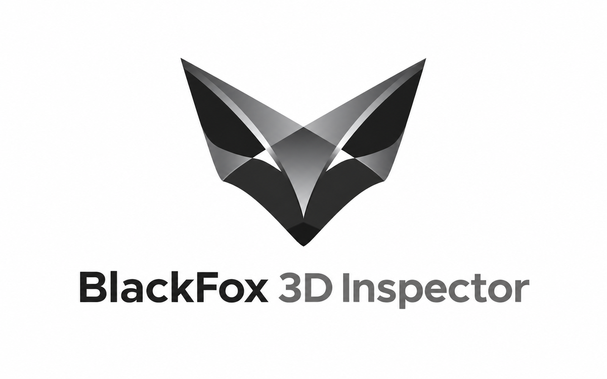

# BlackFox 3D Inspector

**Version 1.1.0 · Free and open-source diagnostic extension for IngeTrazo**

BlackFox 3D Inspector provides a **read-only report** of an IngeTrazo model's geometry and runtime APIs. It is designed for developers and CAD users investigating model data and extension compatibility.

## Features

- Inspect vertices, edges, faces, groups, components, placements and layers.
- Examine curve identifiers, edge topology, colors and material sources.
- Inspect guides, survey/georeference points, dimensions, labels and annotations where available.
- **New in v1.1.0:** inspect material textures and face-level attributes, including texture paths, `sw`, `sh`, `uvw`, `planar`, material assignments and back-face flags.
- Catenary API Watch checks interfaces used by BlackFox Catenary.
- Refresh the report and copy it to the clipboard.
- No geometry, scene data or history is intentionally modified.

Texture `uvw` and `back` values are reported as stored; the inspector does not assume their interpretation.

## Requirements

- **IngeTrazo v0.5.11** (tested target)
- IngeTrazo's bundled Python environment with PySide6

## Installation

1. Download `BlackFox_3D_Inspector_v1_1_0.py` from this repository or release.
2. In IngeTrazo, choose **Extensions → Open plugins folder**.
3. Place the `.py` file in that folder. Remove or disable any earlier BlackFox 3D Inspector plugin to avoid duplicate menus.
4. Restart IngeTrazo.
5. Choose **Extensions → 3D Inspector → 3D Inspector**.

Use **Refresh** to regenerate the report, or **Copy report** to copy it to the clipboard.

## Verification

The v1.1.0 texture diagnostics were exercised on a textured, four-vertex, single-face group in IngeTrazo v0.5.11. The report included the material assignment, embedded texture path, full eight-value `uvw` array and other face attributes. The final source also corrects a missing `Tool` import in Catenary API Watch; that small correction should be checked in-app before publishing the release.

## Project and credits

- **Project creator:** David Mavrov
- **Development assistance:** ChatGPT (OpenAI)
- **BlackFox project:** [BlackFox-CAD](https://github.com/davidsmavrov-debug/BlackFox-CAD)
- **Support:** [Ko-fi](https://ko-fi.com/davidmavrov)

BlackFox 3D Inspector is an independent community extension and is not an official IngeTrazo product.

## License

**GNU General Public License v3.0 or later (GPL-3.0-or-later).** See [LICENSE](LICENSE).

Provided without warranty, to the extent permitted by applicable law.
